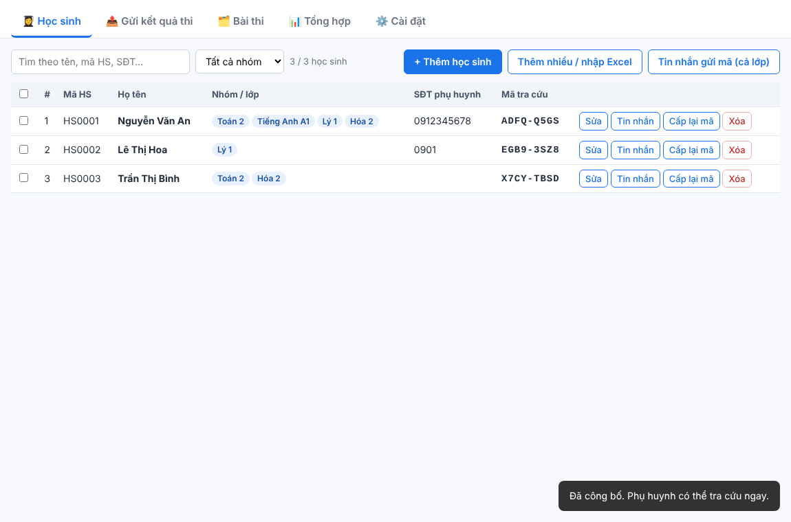
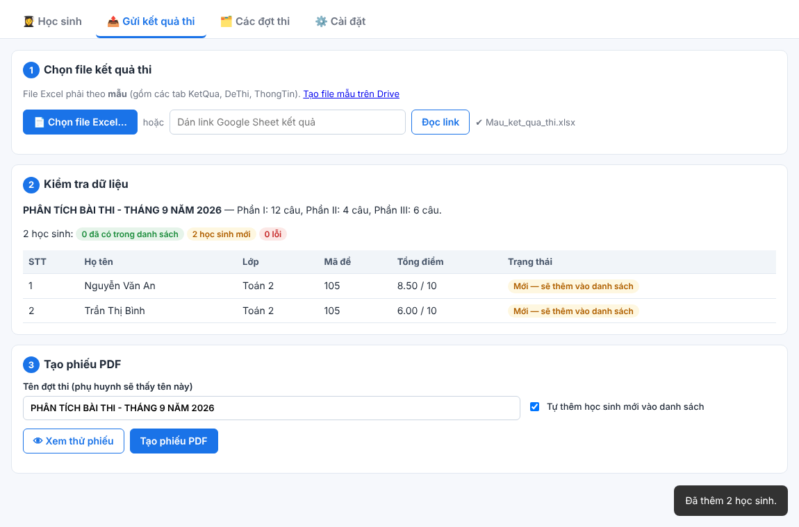
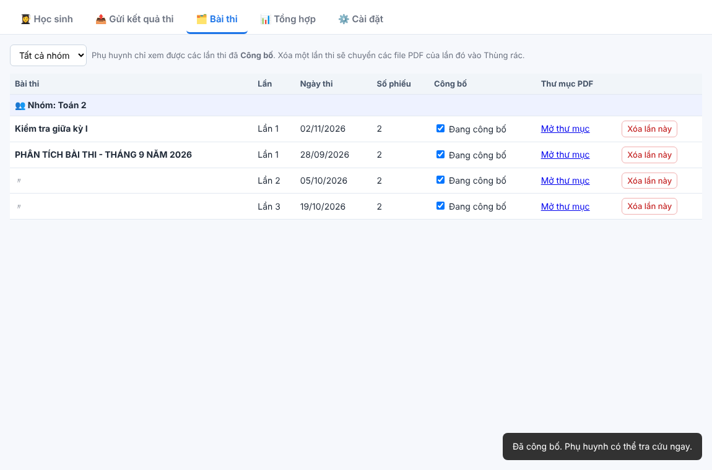
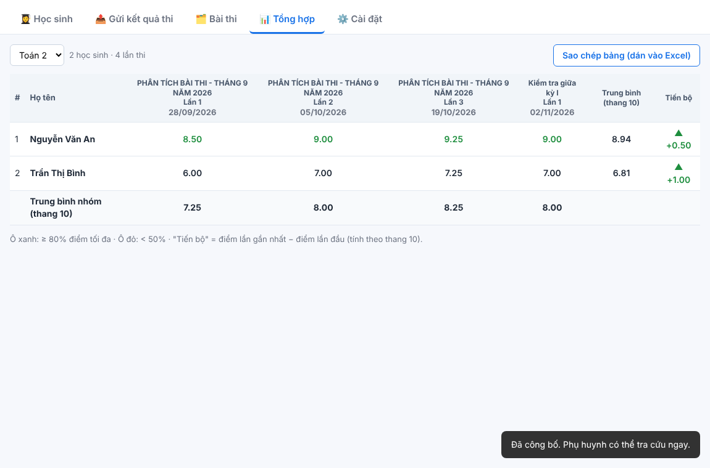
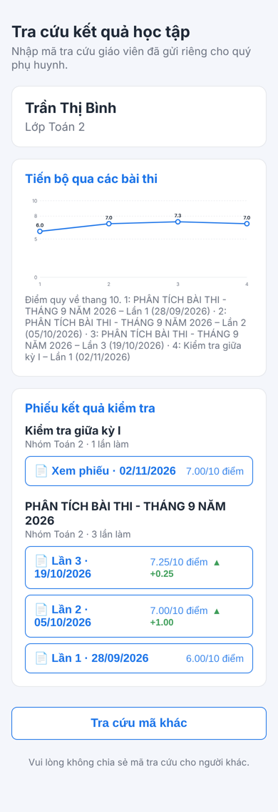
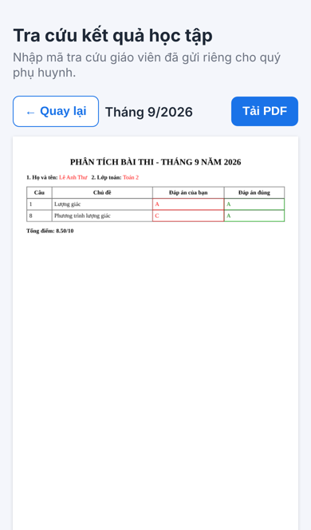

# Hệ thống phiếu kết quả học tập — tra cứu riêng cho từng phụ huynh

Giáo viên **quản lý học sinh theo nhóm/lớp** và **gửi file Excel kết quả thi**. Một nhóm có thể làm **nhiều bài thi**, và mỗi bài thi có thể **làm nhiều lần**.
Một học sinh có thể học **nhiều nhóm/môn**, nhưng **chỉ có một mã tra cứu**: phụ huynh nhập một mã là xem được điểm của mọi môn. Hệ thống tự đọc kết quả, chấm và tính điểm,
xuất **một phiếu PDF cho mỗi học sinh** (có gắn mã phiếu). Phụ huynh nhập **mã tra cứu riêng** và **chỉ xem được phiếu của con mình**.

```
Giáo viên                                                     Phụ huynh
─────────                                                     ─────────
Quản lý học sinh (theo nhóm) ──► mỗi em 1 Mã HS + 1 mã tra cứu ──(nhắn riêng 1 lần)──► nhận mã
Gửi file Excel kết quả ──► chọn Nhóm + Bài thi ──► Lần 1, Lần 2, … ──► PDF / học sinh ──► Công bố ──► nhập mã → xem
                                                                                                    các bài thi, các lần,
Thẻ Tổng hợp: bảng điểm cả nhóm qua mọi bài thi / lần làm, trung bình, tiến bộ                     biểu đồ tiến bộ
```

Cách tổ chức dữ liệu:
```
Học sinh Nguyễn Văn An ── 1 mã tra cứu ── thuộc nhóm: Toán 2 · Tiếng Anh A1 · Hóa 2

Nhóm (vd "Toán 2")
 ├─ Bài thi "Phân tích bài thi tháng 9"
 │    ├─ Lần 1 (28/09) ── phiếu PDF của từng học sinh
 │    ├─ Lần 2 (05/10) ── chỉ những em làm lại
 │    └─ Lần 3 (19/10)
 └─ Bài thi "Kiểm tra giữa kỳ I"
      └─ Lần 1 (02/11)
```

| Quản lý học sinh | Gửi kết quả thi |
|---|---|
|  |  |

| Bài thi & các lần làm | Tổng hợp điểm cả nhóm |
|---|---|
|  |  |

| Phụ huynh: tiến bộ & các lần làm | Phụ huynh: xem phiếu |
|---|---|
|  |  |

**Ai cần làm gì:**

| Người dùng | Cần làm gì | Mở ở đâu |
|---|---|---|
| **Quản trị trung tâm** | Cài đặt **một lần** (khoảng 15 phút, mục A), rồi tạo tài khoản cho giáo viên | Google Sheet của trung tâm |
| **Giáo viên** | **Không cài gì, không cần tài khoản Google**: mở link và đăng nhập | `…/exec?gv` (máy tính hoặc điện thoại) |
| **Phụ huynh** | Nhập mã tra cứu | `…/exec` |

- Miễn phí: chạy trên Google Sheet + Apps Script của trung tâm. Toàn bộ dữ liệu và phiếu PDF nằm trong Drive của trung tâm.
- Link trang tra cứu là link chung, có thể gửi vào nhóm Zalo vì link không chứa thông tin của ai.
- Phiếu có bố cục giống mẫu "Phân tích bài thi": thông tin chung, 3 phần đề thi, đáp án của học sinh (đúng **xanh**, sai **đỏ**), nhận xét, lời khuyên.

---

## Dùng thử trước khi cài
- **Bản dùng thử chạy trên trình duyệt**: file [`demo/index.html`](demo/index.html), chạy đúng mã của hệ thống với Google Sheet/Drive giả lập và dữ liệu mẫu có sẵn.
  Có thể bấm thử cả ba vai: **Quản trị**, **Giáo viên** (đăng nhập bằng tài khoản thử `co.lan` / `demo1234`) và **Phụ huynh**.
  Trong bản dùng thử, phiếu hiển thị dạng HTML thay cho PDF, và không tải file xuống được.
  Sinh lại bản dùng thử sau khi sửa mã: `node tools/tao-demo.js`.
- **Chạy thật**: làm theo mục A bên dưới, mất khoảng 15 phút với một tài khoản Google.
  Sau bước A2 sẽ có link trang tra cứu thật `https://script.google.com/macros/s/…/exec` cho phụ huynh, và `…/exec?gv` cho giáo viên.

---

## A. Cài đặt — chỉ quản trị làm, một lần (khoảng 15 phút)

Nên dùng **một tài khoản Google chung của trung tâm** (ví dụ `ketqua.trungtam@gmail.com`) để mọi dữ liệu ở một chỗ và không phụ thuộc vào cá nhân nào.

### A1. Tạo file và dán mã
1. Vào https://sheets.new để tạo một Google Sheet mới, ví dụ đặt tên "Quản lý kết quả học tập". **Không chia sẻ file này cho ai.**
2. Chọn **Tiện ích mở rộng → Apps Script**.
3. Trong file `Code.gs`: xóa hết nội dung có sẵn, rồi dán toàn bộ nội dung file [`apps-script/Code.gs`](apps-script/Code.gs).
4. Tạo thêm 3 file HTML: bấm **+** cạnh "Tệp" → **HTML**, đặt tên **đúng như sau** (không gõ đuôi `.html`), rồi dán nội dung tương ứng:

   | Tên file | Dán nội dung từ |
   |---|---|
   | `Index` | [`apps-script/Index.html`](apps-script/Index.html) — trang tra cứu cho phụ huynh |
   | `GiaoVien` | [`apps-script/GiaoVien.html`](apps-script/GiaoVien.html) — bảng điều khiển (quản trị và giáo viên dùng chung) |
   | `Phieu` | [`apps-script/Phieu.html`](apps-script/Phieu.html) — bố cục phiếu kết quả |

5. Bấm 💾 **Lưu**.

### A2. Xuất bản trang tra cứu cho phụ huynh
1. Trong Apps Script, bấm **Triển khai → Tùy chọn triển khai mới** → ⚙️ → **Ứng dụng web**.
2. Thiết lập:
   - **Thực thi với tư cách: Tôi**
   - **Người có quyền truy cập: Bất kỳ ai**
3. Bấm **Triển khai** và sao chép link `https://script.google.com/macros/s/…/exec`.

> Tài khoản Google do trường cấp (Workspace) có thể không có lựa chọn "Bất kỳ ai".
> Khi đó hãy dùng Gmail cá nhân, hoặc nhờ quản trị viên của trường bật quyền này.

### A3. Mở bảng điều khiển (quản trị)
1. Quay lại Google Sheet và tải lại trang (F5). Chọn **📋 Kết quả học tập → Mở bảng điều khiển**.
2. Lần đầu, Google sẽ hỏi quyền. Bấm **Tiếp tục**, chọn tài khoản của bạn.
   Nếu thấy cảnh báo "Google chưa xác minh ứng dụng này", bấm **Nâng cao → Đi tới … (không an toàn)** → **Cho phép**.
   Cảnh báo này là bình thường vì đây là mã do chính bạn tạo.
3. Vào thẻ **⚙️ Cài đặt**:
   - Dán **link trang tra cứu** (bước A2).
   - Điền **tên trung tâm**, **khẩu hiệu** và **link logo** (ảnh PNG/JPG trên Drive của bạn) để in lên phiếu.
   - Bấm **Lưu cài đặt**.

### A4. Tạo tài khoản cho giáo viên (thẻ 👥 Giáo viên)
1. Tạo các lớp trước (thẻ Học sinh → **+ Lớp mới**).
2. Vào thẻ **👥 Giáo viên** → **+ Thêm giáo viên**: nhập tên đăng nhập (ví dụ `co.lan`), họ tên, rồi tích **các lớp phụ trách**.
3. Hệ thống tạo **mật khẩu tạm** và soạn sẵn tin nhắn gồm link trang giáo viên, tên đăng nhập và mật khẩu. Mật khẩu tạm **chỉ hiện một lần**, nên sao chép và gửi riêng cho giáo viên ngay.
4. Giáo viên mở link `…/exec?gv`, đăng nhập, rồi nên **đổi mật khẩu** (nút ở góc trên).

| Quản trị làm được | Giáo viên làm được |
|---|---|
| Mọi việc: mọi lớp, tài khoản, cài đặt, mở thư mục PDF trên Drive | Chỉ **các lớp mình phụ trách**: thêm/sửa học sinh, tạo lớp mới (tự giao cho mình), gửi kết quả, công bố, xem tổng hợp |

- Giáo viên quên mật khẩu: quản trị bấm **Đặt lại mật khẩu**.
- Giáo viên nghỉ: **Sửa → Trạng thái: Khóa**. Giáo viên bị đăng xuất ngay, dữ liệu học sinh và phiếu vẫn giữ nguyên.
- Muốn người khác cùng quản trị mà không cần đưa file Google Sheet: tạo tài khoản với vai trò **Quản trị**.
- Khi giáo viên xóa một em đang học thêm lớp của giáo viên khác, em đó chỉ bị bỏ khỏi lớp của giáo viên này. Mã tra cứu và các lớp khác giữ nguyên.

---

## B. Quản lý lớp và học sinh (thẻ 👩‍🎓 Học sinh)

Mỗi học sinh có một **Mã HS** (vd `HS0007`) do hệ thống tự cấp. Mã HS dùng để nhận đúng học sinh khi gửi điểm, nên **file kết quả nên luôn có cột Mã HS**.
File mẫu tải từ bảng điều khiển đã điền sẵn cột này.

| Việc cần làm | Cách làm |
|---|---|
| Tạo lớp/nhóm | **+ Lớp mới**. Lớp có thể chưa có học sinh. |
| Thêm 1 học sinh | **+ Thêm học sinh**, nhập họ tên, lớp, SĐT phụ huynh… Mã HS và mã tra cứu được tự cấp. |
| Thêm cả nhóm | **Thêm nhiều / nhập Excel**: dán các cột *Họ tên – Nhóm/lớp – SĐT phụ huynh* từ Excel, hoặc chọn file Excel danh sách lớp. |
| Học sinh học nhiều nhóm/môn | Ô "Nhóm / lớp" ghi nhiều nhóm, cách nhau bằng dấu `;` (vd `Toán 2; Tiếng Anh A1`). Mỗi em vẫn chỉ có **một** mã tra cứu. |
| Thêm / bỏ / chuyển nhóm hàng loạt | Tích chọn các em → nhập tên nhóm → **Thêm vào nhóm** (giữ các nhóm cũ), **Bỏ khỏi nhóm**, hoặc **Chuyển hẳn sang nhóm**. |
| Đổi tên nhóm | Chọn nhóm ở bộ lọc → **Đổi tên nhóm**. Các bài thi của nhóm được đổi theo. |
| Gửi mã cho phụ huynh | **Tin nhắn** (từng em) hoặc **Tin nhắn gửi mã (cả lớp)**, rồi **Sao chép** và nhắn **riêng 1-1** qua Zalo. |
| Phụ huynh làm lộ mã hoặc quên mã | **Cấp lại mã**: mã cũ hết hiệu lực ngay. Nhớ gửi mã mới cho phụ huynh. |
| Sửa / xóa | Nút **Sửa** / **Xóa** trên từng dòng. Tìm nhanh bằng ô tìm kiếm và bộ lọc lớp. |

Không nhập danh sách trước cũng được: lần đầu gửi kết quả thi, hệ thống sẽ tự thêm học sinh mới vào danh sách.

### Học sinh trùng tên — chống ghép nhầm
Khi thêm học sinh hoặc gửi kết quả của **nhóm/môn khác**, hệ thống phải biết "Nguyễn Văn An" trong file là em đã có hay là một em khác.
Nếu ghép nhầm hai em khác nhau, phụ huynh này sẽ thấy điểm của con người khác. Vì vậy hệ thống **chỉ tự ghép khi chắc chắn**:

| Trường hợp | Hệ thống làm gì |
|---|---|
| File có cột **Mã HS** | Ghép đúng em có mã đó |
| Trùng tên với một em **đã ở trong nhóm này** | Tự ghép |
| Trùng tên và trùng **SĐT phụ huynh** | Tự ghép và thêm nhóm mới cho em đó |
| Trùng tên với em ở **nhóm khác**, không có gì khác để đối chiếu | **Hỏi giáo viên**: "Cùng một em" (dùng chung mã tra cứu) hay "Học sinh khác" (tạo mã riêng) |
| Trong cùng một nhóm có hai em trùng họ tên | Báo lỗi, cần điền cột Mã HS |

Mẹo: thêm cột `Mã HS` hoặc `SĐT phụ huynh` vào file kết quả để hệ thống tự ghép, không phải xác nhận.

---

## C. Gửi kết quả thi (thẻ 📤 Gửi kết quả thi)

### C1. File Excel kết quả theo mẫu
Dùng file mẫu [`mau/Mau_ket_qua_thi.xlsx`](mau/Mau_ket_qua_thi.xlsx), hoặc bấm **Tạo file mẫu trên Drive** trong bảng điều khiển.

| Tab | Nội dung |
|---|---|
| **KetQua** | Mỗi học sinh một dòng: `STT`, `Mã HS` (nên có), `Họ và tên`, `Lớp`, `SĐT phụ huynh` (tùy chọn, giúp nhận đúng học sinh), `Mã đề`, đáp án học sinh chọn `I.1…I.12`, `II.1…II.4` (vd `Đ,S,Đ,S`), `III.1…III.6`, các cột điểm, `Ưu điểm`, `Nhược điểm`, `Hướng khắc phục`, `Lời khuyên`. |
| **DeThi** | Mỗi câu một dòng: `Phần` (I/II/III), `Câu`, `Chủ đề kiến thức`, `Mức độ`, `Nội dung phân tích cụ thể`, `Đáp án đúng`. Nhiều mã đề thì thêm cột `Đáp án mã 106`, `Đáp án mã 107`… |
| **ThongTin** | Tiêu đề phiếu (cũng là tên bài thi mặc định), mô tả, **ngày thi**, nhãn lớp, thang điểm, mô tả từng phần. |
| HuongDan | Hướng dẫn điền, hệ thống không đọc tab này. |

**Tự tính điểm:** cột điểm nào để trống thì hệ thống tự tính:
- Phần I: 0,25 điểm mỗi câu đúng.
- Phần II: tính theo số ý đúng trong câu (1 ý: 0,1 – 2 ý: 0,25 – 3 ý: 0,5 – 4 ý: 1 điểm).
- Phần III: 0,5 điểm mỗi câu đúng.
- Tổng điểm: cộng 3 phần.

Nếu giáo viên đã nhập điểm (ví dụ chấm tay phần tự luận) thì hệ thống dùng điểm giáo viên nhập.
Muốn thêm hoặc bớt câu: thêm/xóa cột trong KetQua (vd `I.13`) và dòng tương ứng trong DeThi.

### C2. Các bước — luôn chọn lớp trước
1. **Chọn lớp/nhóm**. Màn hình hiện danh sách học sinh của lớp (họ tên và Mã HS).
   Bấm **⬇ Tải file mẫu Excel của lớp**: file đã điền sẵn STT, **Mã HS** và họ tên của cả lớp. Giáo viên chỉ điền đáp án, điểm và nhận xét.
2. **Chọn file kết quả** (Excel hoặc link Google Sheet). Hệ thống ghép từng dòng với **học sinh trong lớp**:

   | Dòng trong file | Kết quả ghép |
   |---|---|
   | Có Mã HS của học sinh trong lớp, họ tên khớp | ✔ Tự ghép |
   | Không có Mã HS, họ tên khớp đúng 1 em trong lớp | ✔ Tự ghép |
   | Mã HS không có trong hệ thống / họ tên khác với Mã HS / em thuộc lớp khác / tên không có trong lớp (thường do gõ sai) | ⚠ **Cần chọn**: chọn đúng em trong danh sách lớp, em ở lớp khác (sẽ được thêm vào lớp), **Học sinh mới**, hoặc **Bỏ qua** |
   | Lớp chưa có học sinh nào (lần gửi đầu tiên) | Tự thêm các em trong file vào lớp |

   Bên dưới bảng hiện danh sách **học sinh trong lớp không có kết quả** trong file (vắng thi). Các em này không có phiếu.
3. Bấm **👁 Xem thử phiếu** để xem phiếu của học sinh đầu tiên.
4. Nhập **Tên bài thi** và **Ngày thi**. Hệ thống báo ngay kết quả này sẽ là lần làm thứ mấy:
   - 🆕 **Bài thi mới** của nhóm: ghi thành **Lần 1**.
   - 🔁 **Bài thi đã có** (chọn đúng tên cũ trong danh sách gợi ý): ghi thành **Lần 2, Lần 3…**. Các lần trước được **giữ nguyên**.
     File lần làm lại chỉ cần có những em làm lại.
   - Gửi nhầm hoặc cần sửa điểm: tích **"ghi đè lần gần nhất"**. Phiếu cũ của lần đó bị thay thế.
5. Bấm **Tạo phiếu PDF**. Thanh tiến độ chạy; một lớp 40 em mất khoảng vài phút.
   Từ lần 2 trở đi, phiếu có thêm bảng **"Kết quả các lần làm"** và mục **so với lần trước** (▲/▼).
6. Mở **thư mục PDF** để kiểm tra vài phiếu, rồi bấm **📢 Công bố cho phụ huynh xem**.

### C3. Bài thi (thẻ 🗂️)
Danh sách bài thi theo nhóm, mỗi bài liệt kê các lần làm. Có thể **công bố / ẩn** từng lần, mở thư mục PDF, hoặc **xóa một lần** (file PDF chuyển vào Thùng rác).

### C4. Tổng hợp (thẻ 📊)
Chọn nhóm để xem bảng **học sinh × (bài thi, lần làm)** theo thứ tự ngày thi.
- Mỗi học sinh có **điểm trung bình** và **tiến bộ** (lần gần nhất so với lần đầu, quy về thang 10).
- Có **dòng trung bình của cả nhóm**.
- Bấm **Sao chép bảng** để dán sang Excel hoặc Google Sheet.

---

## D. Phụ huynh tra cứu
1. Mở link trang tra cứu (link chung của lớp).
2. Nhập mã tra cứu đã nhận riêng, ví dụ `K7X9-2QMP`.
3. Trang hiện kết quả **theo từng nhóm/môn** mà con đang học. Mỗi nhóm có **biểu đồ tiến bộ riêng** và danh sách phiếu, xếp theo từng bài thi. Mỗi bài có các lần làm, kèm điểm và mức tăng/giảm so với lần trước.
   Chỉ hiện các lần **đã công bố**. Bấm vào một phiếu để xem ngay trên điện thoại, hoặc bấm **Tải PDF**.

---

## Vì sao an toàn?
- **File Sheet, các phiếu PDF và thư mục đều riêng tư** trong Drive của giáo viên. Không file nào được chia sẻ.
- Trang tra cứu **kiểm tra mã ở mỗi lần xem**. Mỗi mã chỉ mở được phiếu của đúng học sinh đó, và chỉ những đợt đã công bố.
- **Mã tra cứu ngẫu nhiên** gồm 8 ký tự (khoảng 850 tỷ khả năng), không dựa trên tên hay ngày sinh. Mã phiếu in trên PDF không dùng để tra cứu được.
- **Chống dò mã:** mỗi lần nhập sai bị chậm 1 giây. Nếu cả hệ thống có quá 30 lần nhập sai trong một phút, trang tra cứu tạm khóa.
- **Các chức năng quản lý chỉ chạy khi là chủ file, hoặc có phiên đăng nhập hợp lệ.** Mỗi thao tác đều được kiểm tra quyền theo lớp ở máy chủ.
- **Mật khẩu giáo viên** được lưu dạng mã hóa (SHA-256 nhiều vòng, có muối riêng), không lưu dạng chữ thường. Phiên đăng nhập hết hạn sau 6 giờ không dùng. Đăng nhập sai nhiều lần sẽ bị tạm khóa.
- Mọi thao tác chạy bằng tài khoản của trung tâm. Vì vậy giáo viên chỉ đọc được link Google Sheet đã chia sẻ công khai bằng link, không đọc được các file riêng khác trong Drive của trung tâm.

## Tùy chỉnh
- **Giao diện phiếu:** sửa file `Phieu.html` (màu, cỡ chữ, tiêu đề các phần…).
- **Thang điểm, độ dài mã, giới hạn nhập sai:** sửa biến `CAU_HINH` ở đầu `Code.gs`.
- **Sau khi sửa mã:** vào **Triển khai → Quản lý các lượt triển khai → ✏️ → Phiên bản mới → Triển khai**. Làm như vậy thì link tra cứu giữ nguyên.

## Cấu trúc thư mục
```
apps-script/
  Code.gs          Máy chủ: quản lý học sinh, đọc file kết quả, chấm điểm, tạo PDF, tra cứu
  GiaoVien.html    Bảng điều khiển của giáo viên (mở từ Google Sheet)
  Index.html       Trang tra cứu cho phụ huynh (xem PDF ngay trên điện thoại)
  Phieu.html       Bố cục phiếu kết quả
  appsscript.json  Cấu hình (chỉ cần khi dùng công cụ clasp)
mau/
  Mau_ket_qua_thi.xlsx   File Excel mẫu kết quả thi
demo/
  index.html             Bản dùng thử chạy trên trình duyệt (sinh tự động, không sửa tay)
tools/
  tao-file-mau.js        Sinh lại file Excel mẫu từ Code.gs (npm install xlsx@0.18.5 && node tools/tao-file-mau.js)
  tao-demo.js            Sinh lại demo/index.html từ mã hệ thống (node tools/tao-demo.js)
  demo-khung.html        Khung bản dùng thử: giả lập Google Sheet/Drive trong trình duyệt
docs/                    Ảnh minh họa
```

Dữ liệu được lưu trong các tab của Google Sheet: `HocSinh` (cột "Nhóm / lớp" ghi các nhóm, cách nhau bằng `;`), `Nhom` (danh sách lớp), `TaiKhoan` (tài khoản giáo viên), `DotThi` (mỗi dòng là một lần làm của một bài thi), `PhieuKetQua`. Nên thao tác qua bảng điều khiển; sửa trực tiếp trên tab sẽ có cảnh báo.
